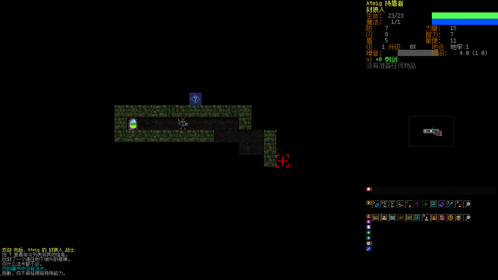
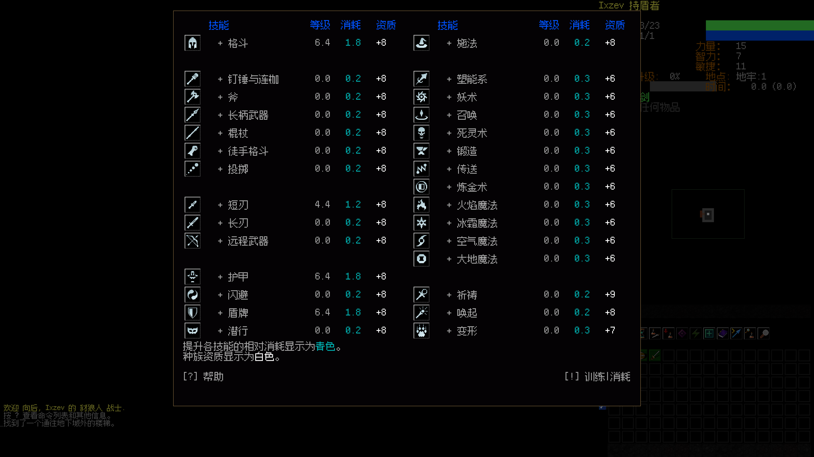

# DCSS 中文版

基于 Dungeon Crawl Stone Soup **0.34.1 稳定版**的非官方简体中文原生版本，提供 macOS Apple Silicon 与 Bazzite / Fedora x86_64 图形版和终端版。

[上游 DCSS](https://github.com/crawl/crawl) · [像素字体来源](https://github.com/TakWolf/fusion-pixel-font)

## 下载与运行

从 [GitHub Release](https://github.com/Drafffffff/DCSS-zh/releases/latest) 下载对应运行包，解压后启动。Release 同时提供游戏源码、适用的第三方依赖源码与 SHA256 校验文件。

| 系统 | 下载文件 | 启动方式 |
| --- | --- | --- |
| macOS 26+，Apple Silicon | `DCSS-zh-0.34.1-zh.1-macos-arm64.zip` | 打开应用；终端版使用同目录的 `.command` |
| Bazzite / Fedora 43+，x86_64 | `DCSS-zh-0.34.1-zh.1-bazzite-x86_64.tar.gz` | 运行 `./dcss-zh`；4K 屏使用 `./dcss-zh-4k`；终端版使用 `./dcss-zh-console` |

macOS 包已包含运行库，无需另装 Homebrew；应用未经过 Apple 公证。首次打开若被系统拦截，可在“系统设置 → 隐私与安全性”中允许打开。
Linux 包包含 SDL2_image / SDL2_mixer，SDL2 与基础系统库使用 Bazzite / Fedora 43+ 提供的版本；不需要 Proton。已在 Bazzite 验证，其他 Linux 发行版尚未验证。

在 Steam 桌面模式选择“添加非 Steam 游戏”，4K 屏选择 `dcss-zh-4k`，普通屏选择 `dcss-zh`。4K 入口通过启动参数应用配置，不覆盖用户配置。

存档独立保存：macOS 使用 `~/Library/Application Support/DCSS-zh/0.34`，Linux 使用 `${XDG_DATA_HOME:-~/.local/share}/dcss-zh/0.34`。更新时替换运行包即可，保留该目录。

## 汉化与画面

- 中文词库包含 23,226 条有效条目；数据文件 5,803 个条目全部具备中文正文。
- 图形技能菜单、技能说明、装备详情、帮助和消息均接入中文显示；保留用于存档、Lua 和输入解析的英文内部标识。
- 游戏文案由本机 Pi Agent 的 DeepSeek Flash 翻译，当前模型为 `cc-switch-deep-seek/deepseek-flash`。已保存的翻译记录可用于重建，无需模型服务。
- 使用 **DCSS Pixel SC**：以 Fusion Pixel 12px 简体等宽字体为基础，13 个汉字和“∞”使用 Noto Sans SC Regular 补齐。覆盖当前词库的全部可见字符。
- 4K 原生全屏：地图 96px（3 倍），侧栏图块 64px（2 倍）；菜单/状态文字 48px，消息/提示 36px。关闭平滑插值。
- 修复中文字体列宽估算、精确菜单翻译入口、动态说明拆行匹配，以及侧栏分类标签放大后的命中区域偏移。
- Steam 继承 `LC_ALL=C` 时自动回退到 UTF-8 字符处理，避免中文消息宽度被算成零、越过物品栏。
- 人偶编辑器根据字体度量布局；状态页先翻译再计算列宽；中文长帮助页的字形缓存扩为 4,096 个槽位，避免花字和串字。





覆盖率是数据条目与已测试界面的统计，不代表所有随机事件都已穷尽。运行跟踪包含物品、技能、法术、帮助等已执行路径，排除玩家姓名、路径与按键标识后未发现未分类英文。发现遗漏可提交截图与触发步骤。

## 从源码构建

完整游戏源码与当前构建所需的 contrib 依赖源码位于 `native/crawl-ref/`；已随仓库提供，不需要初始化子模块。

macOS：

```sh
brew install pkg-config freetype sdl2 sdl2_image sdl2_mixer
sh scripts/build-macos.sh
```

Fedora / Bazzite 的可写开发容器：

```sh
sudo dnf install gcc-c++ make pkgconf-pkg-config ncurses-devel SDL2-devel SDL2_image-devel SDL2_mixer-devel freetype-devel sqlite-devel zlib-devel which diffutils python3
sh scripts/build-linux.sh
```

字体已预生成。需要重建衍生字体时，安装 `requirements-fonts.txt` 并运行 `python3 tools/build_pixel_font.py`。
使用 Pi 增补翻译时，运行 `tools/native_catalog.py translate`；词库编译与回归检查使用：

```sh
python3 tools/native_catalog.py compile
python3 tools/test_native_catalog.py
```

## 验证与许可

验证包含两端原生构建、C++ 翻译模板回归、独立存档 PTY 测试、Lua 消息兼容性、图形技能菜单截图和 Bazzite Steam 实际点击检查。数据及界面审计记录在 `verification/`。

游戏遵循上游 `LICENSE`（GPL-2.0-or-later），原作者与素材声明保留在 `native/` 中。字体使用 SIL OFL 1.1；衍生字体已更名，完整声明在 `fonts/OFL.txt` 与 `fonts/fusion-pixel-licenses/`。
macOS 打包脚本会收集第三方运行库的许可证与版本清单；相关源码地址位于 `verification/macos-library-sources.json`。Release 中的 third-party-sources 附件提供适用的 GPL/LGPL 源码、构建配方和补丁。SteamGridDB 封面素材不包含在仓库中。
